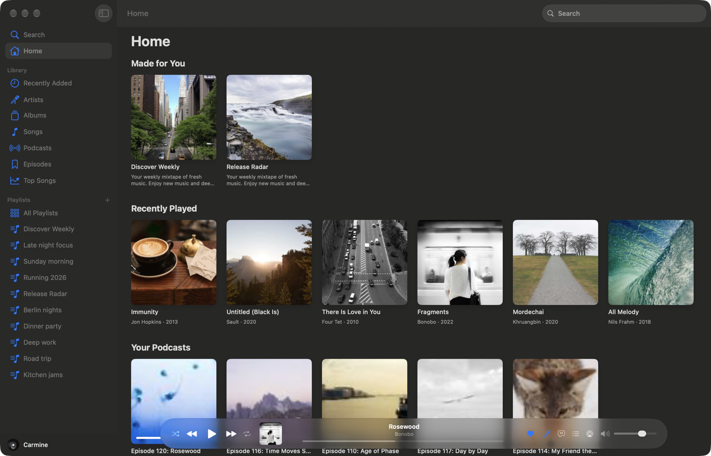
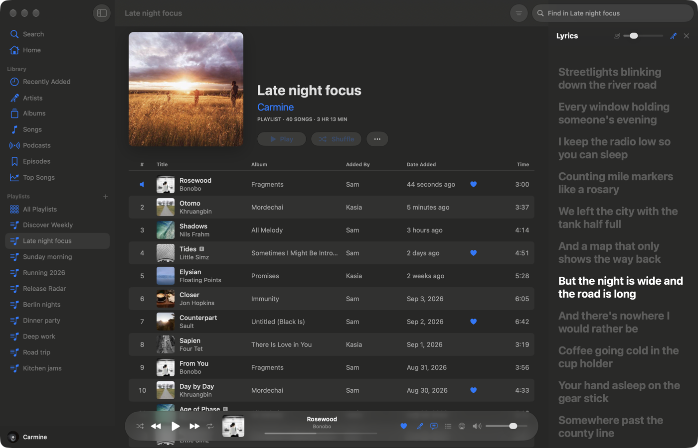
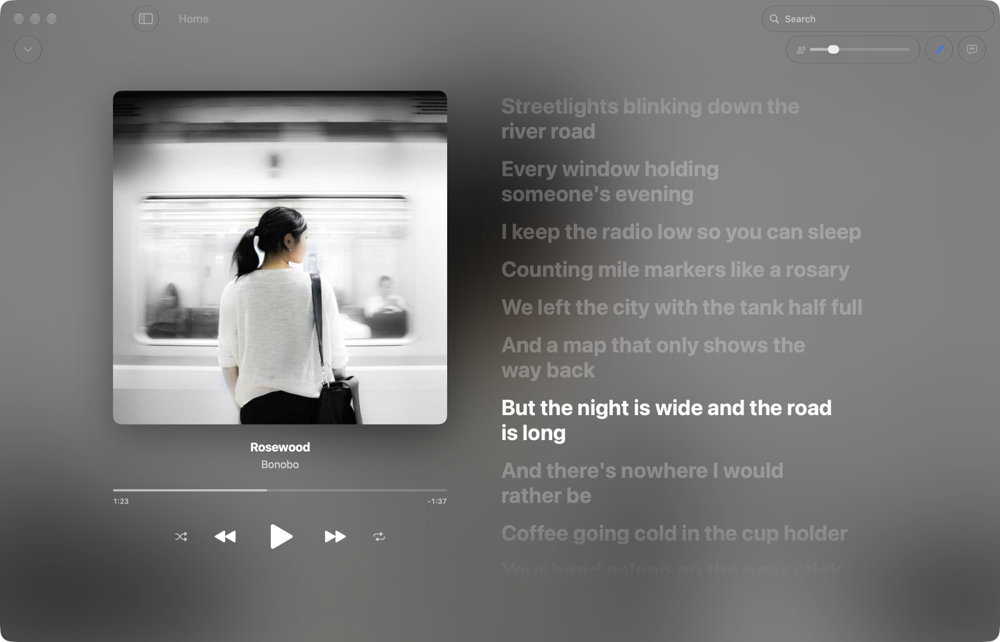
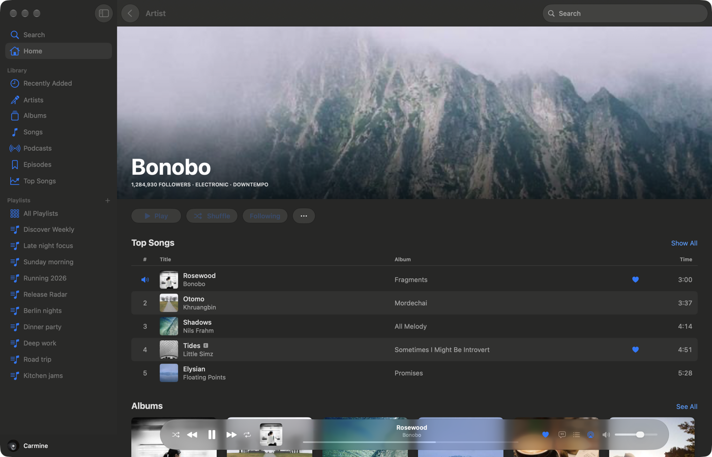

# SwiftSpot

**A native Spotify client for the Mac, made to feel like Apple Music.**
SwiftSpot is a SwiftUI app over a small Rust engine that plays through
[librespot](https://github.com/librespot-org/librespot). There is no browser
engine anywhere: the whole thing runs in about 140 MB.

**Playback needs Spotify Premium.**



## What it does

- **Apple Music's layout:** a sidebar library, Home, Search, artist, album,
  playlist and podcast pages, and a Liquid Glass player bar.
- **Karaoke:** the microphone takes the voice out of the song. A vocal
  separation model runs on the Neural Engine, on your Mac, and a slider
  sets how much of the voice stays.
- **Lyrics:** time-synced, following the song, and a line seeks when
  clicked. There's also a full-window player with the lyrics beside it.
- **Your library:** playlists you can create, edit and reorder, including
  removing just one copy of a duplicated song. Also Liked Songs, Recently
  Added, Top Songs, albums, artists, podcasts and saved episodes.
- **The queue:** Playing Next, which you can reorder and remove songs from,
  and History.
- **Everything else:** Spotify Connect devices, a mini player, a sleep
  timer, a ten-band equalizer, and Apple Music's keyboard shortcuts.







## How it works

Two processes, one app:

- **The engine** (`src/`) keeps the Spotify session, plays the audio, and
  holds the library, the queue and the caches. It runs inside the app,
  with no window, and quits with it.
- **The app** (`apple/`) is SwiftUI. It drives the engine over a local
  socket; [apple/README.md](apple/README.md) lists the API.

Pages are read the way Spotify's own apps read them, from Spotify's
GraphQL service, so they don't wait on the Web API's tight rate limits.
Lyrics, artwork, pages and audio are cached on disk.

## Install

You need macOS 26 or later on Apple silicon, Swift 6.2 (Xcode 26), and
Rust ([mise](https://mise.jdx.dev) installs the right version).

```sh
git clone https://github.com/hanzpo/swiftspot
cd swiftspot
mise trust
apple/install.sh
```

The script builds the engine and the app, signs them with your Apple
Development certificate if you have one, installs `SwiftSpot.app` into
`/Applications` and opens it. Sign in with Spotify in the browser it opens.

### Your own Spotify app (optional)

Out of the box, SwiftSpot shares a public Web API app with other clients,
and that app is often rate-limited. To use one of your own:

1. Create an app at
   [developer.spotify.com/dashboard](https://developer.spotify.com/dashboard),
   with the redirect URI `http://127.0.0.1:8989/login` and the Web API.
2. Put its client ID in
   `~/Library/Application Support/me.paolino.spotifast/settings.json` as
   `"web_client_id": "…"`, then restart SwiftSpot.

## Karaoke

The first time you turn karaoke on, SwiftSpot downloads its vocal model
(33 MB) from a fixed revision on Hugging Face and checks it against
digests built into the app. The model is UVR's MDX-Net "Voc FT" by
Kimberley Jensen, in the Core ML conversion by
[gyoom](https://huggingface.co/gyoom/UVR-MDX-CoreML) (MIT). It holds the
music back by about a second so it can hear a little ahead; the lyrics and
the progress bar account for that.

## Credits

SwiftSpot is a fork of [Spotifast](https://github.com/crmne/spotifast) by
Carmine Paolino, whose Rust client is the engine here, and it keeps
Spotifast's MIT license. It plays through
[librespot](https://github.com/librespot-org/librespot).

SwiftSpot is an independent project and is not affiliated with Spotify or
Apple. Spotify is a trademark of Spotify AB.

Licensed under the [MIT License](LICENSE).
